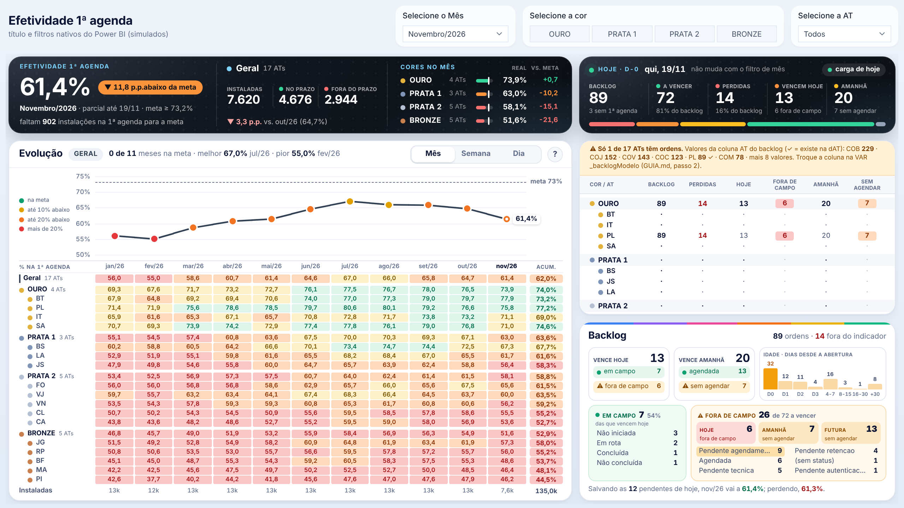
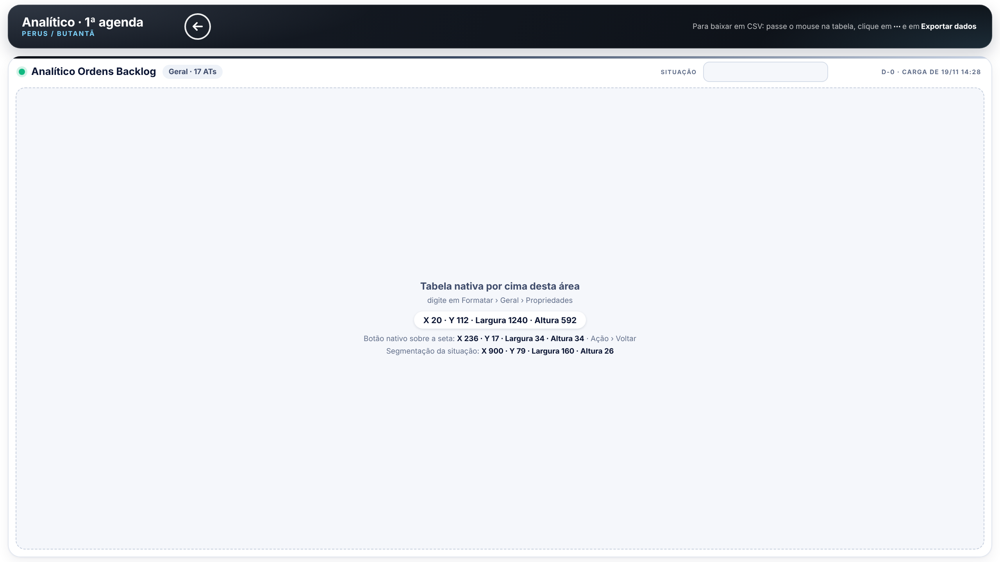
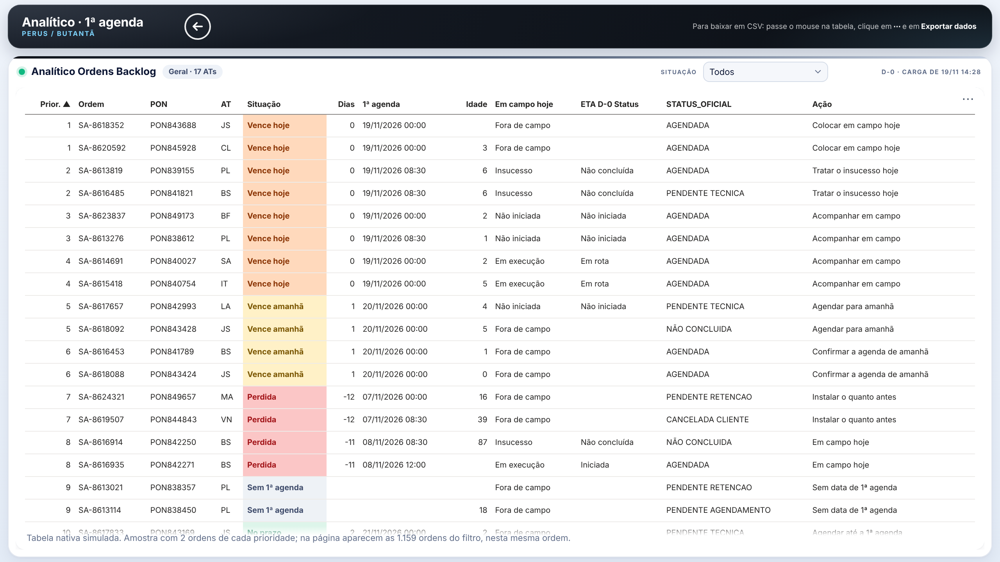

# Guia de montagem · Efetividade 1ª agenda

Tudo o que você precisa criar no Power BI, na ordem. Os códigos estão nos arquivos `.txt` desta pasta; cada um começa com o nome que a medida (ou tabela) vai ter.

**No fim você terá:** 1 tabela nova, 15 medidas novas, o menu atualizado e 2 páginas: o painel e o analítico oculto, no mesmo modelo da tela do Analítico INST3D.

---

## 0. Padrões do seu modelo (o que achei nos outros painéis)

Conferi os códigos do BSC, IFI, IRR, ranking, projeção e Instalação 3D. Este painel segue os mesmos padrões:

| Tabela | Colunas usadas | Como liga | Já usada em |
|---|---|---|---|
| `dAT` | `[AREA ]` = sigla da AT (17) · `[COR_AREA ]` = OURO, PRATA 1, PRATA 2, BRONZE. **Os dois nomes terminam com espaço.** | dimensão das ATs; as segmentações de cor e AT usam ela | todas as páginas |
| `dCalendario` | `[Data]` (e `[Mês e Ano]`, `[Semana_Range]`) | relacionada às tabelas f pela data | BSC, IFI, IRR, 3D |
| `dFeriados` | `[Data]` | lista de feriados (este painel não usa: o prazo é o dia da 1ª agenda) | 3D |
| `'f1AGENDA_PRAZO'` e `'f1AGENDA_TOTAL'` | `[num_Total]` (e `[DAT_REFERENCIA]`, que o BSC usa como data da base) | **relacionadas** com `dAT` e `dCalendario`, como para a sua `% 1_AGENDA` | BSC |
| `'ETA DIRECT D-0'` | `[AT]`, `[PON]`, `[Número da Ordem de Serviço]`… | **sem relacionamento**: o painel filtra pela coluna `[AT]`, que tem as mesmas siglas da `dAT[AREA ]` | 3D |
| `BACKLOG_INSTALACAO` | `[DATA_PRIMEIRA_AGENDA]`, `[ETA DIRECT D-0.Status]`, `[STATUS_OFICIAL]`, `[DATA_ABERTURA]`, `[DATA_CARGA]` e **a coluna da AT** | **sem relacionamento**, igual à ETA: filtra pela coluna da AT | este painel |
| Seletores (`'Seletor Cor'`, `'Seletor Indicador BSC'`…) | — | tabelas soltas, sem relacionamento | BSC |

**Conclusão:** o lado direito do painel só funciona se a `BACKLOG_INSTALACAO` tiver uma coluna com **as mesmas siglas da `dAT[AREA ]`**, como a `[AT]` da ETA. No print das colunas do backlog não existe uma coluna `AT`. Eu usei `CENTRAL_OFFICE` por palpite, e o seu print mostrou que ela não é a sigla: só a LP bateu. O passo 2 resolve isso.

---

## 1. Checklist

Marque conforme for fazendo.

### Medidas e tabela
- [ ] `1_AGENDA NO PRAZO` · arquivo `medidas_de_apoio_1agenda_v1.txt`
- [ ] `1_AGENDA TOTAL` · mesmo arquivo
- [ ] `Painel Efetividade 1 Agenda HTML` · `painel_efetividade_1agenda_html_v1.txt`
- [ ] `Barra Filtros 1 Agenda HTML` · `barra_filtros_1agenda_html_v1.txt`
- [ ] **Tabela** `Seletor Situacao 1AG` · 1º bloco de `analitico_1agenda_v1.txt` (Modelagem › Nova tabela)
- [ ] 10 medidas do analítico, mesmo arquivo, uma por vez: `1AG Dias até a 1ª Agenda`, `1AG Situação`, `1AG Situação em Campo`, `1AG Agendamento`, `1AG Idade`, `1AG Prioridade`, `1AG Ação`, `1AG Cor Fundo`, `1AG Cor Texto`, `1AG No Filtro`
- [ ] `Tela Analitico 1 Agenda HTML` · `tela_analitico_1agenda_html_v1.txt`
- [ ] Menu: troque o código das medidas de menu que você já usa pelo `menu_lateral_instalacao_html_v2.txt`

### Ajustes no código
- [ ] Coluna da AT do backlog (**passo 2**), em 2 lugares
- [ ] Meta `_meta = 0.732` no painel: confira se é a meta do 1 AGENDA

### Páginas
- [ ] Página `EFETIVIDADE 1 AGENDA` (passo 4)
- [ ] Página `ANALÍTICO 1 AGENDA`, oculta (passo 5)
- [ ] Botão novo no menu de todas as páginas (passo 6)
- [ ] Conferência (passo 8)

---

## 2. Coluna da AT (o "só aparece LP")

### 2.1 Descubra o que a coluna traz
Com o painel novo, a **faixa amarela** em cima do quadro por cor/AT mostra os valores que a coluna da AT trouxe, com a quantidade de ordens. `✓` marca os que existem na `dAT`.



Para olhar outras colunas, ponha um visual **Tabela** numa página qualquer com uma coluna do backlog e a contagem de linhas. Teste uma de cada vez: `CENTRAL_OFFICE`, `CLUSTER_`, `CIDADE`, `DESC_GRUPO…` e qualquer coluna de texto que tenha "AT", "AREA", "ESTACAO" ou "SIGLA" no nome. Você procura a coluna cujos valores são **as 17 siglas da `dAT[AREA ]`**: AB, AG, BD, BF, BS, FO, JG, JR, LP, MA, MD, MG, PL, PU, RP, VJ e VN.

Se você usa a Exibição de consulta DAX, esta consulta faz o mesmo (troque o nome da coluna):

```
EVALUATE
SUMMARIZECOLUMNS(
    'BACKLOG_INSTALACAO'[CENTRAL_OFFICE],
    "Ordens", COUNTROWS( 'BACKLOG_INSTALACAO' )
)
ORDER BY [Ordens] DESC
```

### 2.2 Corrija, conforme o que achou

**A) Achou uma coluna com as siglas.** Troque `CENTRAL_OFFICE` pelo nome dela em dois lugares (Ctrl+F por `CENTRAL_OFFICE` acha os dois):
- painel, VAR `_backlogModelo`: `"AT", TRIM( 'BACKLOG_INSTALACAO'[CENTRAL_OFFICE] ),`
- medida `1AG No Filtro`: `VAR _at = TRIM( SELECTEDVALUE( 'BACKLOG_INSTALACAO'[CENTRAL_OFFICE] ) )`

**B) A sigla está lá, mas em outro formato** (ex.: `SPO-LP`, `LP - LAPA`, `lp`). Me mande 5 exemplos de valores que eu ajusto a fórmula nos dois lugares.

**C) Nenhuma coluna tem a sigla, mas uma tem um código que você sabe de qual AT é** (central, estação). Crie um de-para:

1. Modelagem › Nova tabela, com um par por linha (o valor da coluna e a sigla da AT). Cada valor só pode aparecer uma vez na coluna `De`:
```
De Para AT 1AG =
DATATABLE(
    "De", STRING,
    "AT", STRING,
    {
        { "VALOR DA COLUNA", "SIGLA DA AT" },
        { "VALOR DA COLUNA", "SIGLA DA AT" }
    }
)
```
2. No painel, troque a linha `"AT", TRIM( 'BACKLOG_INSTALACAO'[CENTRAL_OFFICE] ),` por:
```
"AT",
    VAR _v = TRIM( 'BACKLOG_INSTALACAO'[CENTRAL_OFFICE] )
    RETURN COALESCE( LOOKUPVALUE( 'De Para AT 1AG'[AT], 'De Para AT 1AG'[De], _v ), _v ),
```
3. Na `1AG No Filtro`, troque a linha `VAR _at = …` por:
```
VAR _v = TRIM( SELECTEDVALUE( 'BACKLOG_INSTALACAO'[CENTRAL_OFFICE] ) )
VAR _at = COALESCE( LOOKUPVALUE( 'De Para AT 1AG'[AT], 'De Para AT 1AG'[De], _v ), _v )
```

**D) Pelo Power Query.** Se outra consulta tiver o código e a AT juntos, mescle a `BACKLOG_INSTALACAO` com ela e expanda a AT, do mesmo jeito que você trouxe o `ETA DIRECT D-0.Status`. Depois use a coluna nova como na opção A.
> Não use a `'ETA DIRECT D-0'` para isso: ela só tem as ordens que estão em campo hoje, e o resto do backlog ficaria sem AT.

Quando a coluna estiver certa, a faixa amarela some e as ordens se espalham pelas 17 ATs.

---

## 3. Criar as medidas e a tabela

1. **Medidas de apoio.** Nova medida › cole `1_AGENDA NO PRAZO`. Repita com `1_AGENDA TOTAL`. Elas são o numerador e o denominador da sua `% 1_AGENDA`; o painel usa as duas.
2. **Painel.** Nova medida › cole o arquivo do painel inteiro (o nome vem na 1ª linha).
3. **Barra.** Nova medida › cole o arquivo da barra.
4. **Tabela do seletor.** Modelagem › Nova tabela › cole o bloco `Seletor Situacao 1AG`. Selecione a coluna `Situação 1AG` › Ferramentas de coluna › **Classificar por coluna** › `Ordem Situação 1AG`. Não crie relacionamento.
5. **Medidas do analítico.** Nova medida para cada bloco `1AG …`, uma por vez. Formatos: `1AG Dias até a 1ª Agenda`, `1AG Idade` e `1AG Prioridade` como número inteiro.
6. **Tela do analítico.** Nova medida › cole o arquivo da tela do analítico.
7. **Menu.** Em cada medida de menu que você já tem (uma por página), troque o código pelo do `menu_lateral_instalacao_html_v2.txt` e ajuste só `_paginaAtual` para o nome da página. O menu da página nova usa `"EFETIVIDADE 1 AGENDA"`. O analítico não tem menu.

> Se aparecer **"Não é possível localizar a coluna f1AGENDA_TOTAL"**: o código está pedindo `[f1AGENDA_TOTAL]`, que é o nome da tabela. Crie as medidas do item 1 e use `[1_AGENDA NO PRAZO]` e `[1_AGENDA TOTAL]`.

---

## 4. Página EFETIVIDADE 1 AGENDA

O caminho mais curto é **duplicar a página da Instalação 3D** e renomear para `EFETIVIDADE 1 AGENDA`. O menu, a barra e as segmentações já vêm.

Posições (página 1280 × 720; em Formatar › Geral › Propriedades › Tamanho e Posição):

| Visual | Campo / medida | X | Y | Largura | Altura |
|---|---|---|---|---|---|
| Menu (HTML) | medida de menu com `_paginaAtual = "EFETIVIDADE 1 AGENDA"` | 20 | 6 | 200 | 700 |
| Barra (HTML) | `Barra Filtros 1 Agenda HTML` | 236 | 6 | 1032 | 62 |
| Segmentação Mês | o mesmo campo de mês da página da 3D | 480 | 30 | 160 | 26 |
| Segmentação Cor | `dAT[COR_AREA ]` | 658 | 30 | 160 | 26 |
| Segmentação AT | `dAT[AREA ]` | 836 | 30 | 160 | 26 |
| Botão Baixar CSV | botão nativo em branco | 1136 | 21 | 116 | 32 |
| Painel (HTML) | `Painel Efetividade 1 Agenda HTML` | 236 | 80 | 1032 | 630 |

**Visuais HTML:** sem título, tela de fundo desligada.

**Segmentações** (estilo Lista suspensa): Cabeçalho da segmentação **desligado**; Valores em Segoe UI 10, cor **branca**; em Geral › Efeitos, Tela de fundo, Borda visual e Sombra **desligadas**. Sem isso aparece a moldura branca do seu print.

**Botão Baixar CSV:** Inserir › Botões › Em branco.
- Ação: Tipo **Navegação de página**, Destino `ANALÍTICO 1 AGENDA`.
- Estilo › Preenchimento: 100% transparente.
- Em "Ao passar o mouse": branco com 85% de transparência.
- O Power BI não tem ação que baixe arquivo: o botão leva à página do analítico, e lá a tabela é exportada.

Traga as segmentações e o botão para a frente (Formatar › Organizar › Trazer para a frente).


---

## 5. Página ANALÍTICO 1 AGENDA (oculta)

Mesmo modelo da tela do **Analítico INST3D**: página sem menu. Um visual HTML do tamanho da página desenha o cabeçalho, a seta de voltar e o cartão. Por cima dele ficam:
- a **tabela nativa**, que é a que exporta o CSV (o visual HTML não exporta dados);
- um **botão nativo** sobre a seta.

A própria tela escreve, na área tracejada, a posição de cada peça.



1. Crie uma página nova, `ANALÍTICO 1 AGENDA`. Não ponha o menu nela.
2. Visual **HTML** com a medida `Tela Analitico 1 Agenda HTML`, em X 0, Y 0, 1280 × 720. Deixe sem título e com a tela de fundo desligada. Se o visual ficar em outra posição ou tamanho, troque `_visX`, `_visY`, `_visL` e `_visA` na medida: as posições escritas na tela se ajustam sozinhas.
3. Visual **Tabela** por cima da área tracejada, em **X 20, Y 112, 1240 × 592**.
4. Arraste para **Colunas**, nesta ordem:
   1. `1AG Prioridade`
   2. a coluna do **número da ordem** do backlog (obrigatória: é ela que faz cada linha ser uma ordem)
   3. PON (se o backlog tiver)
   4. a coluna da AT (a mesma do passo 2)
   5. `1AG Situação`
   6. `1AG Dias até a 1ª Agenda`
   7. `DATA_PRIMEIRA_AGENDA`
   8. `1AG Idade`
   9. `1AG Situação em Campo`
   10. `ETA DIRECT D-0.Status`
   11. `STATUS_OFICIAL`
   12. `1AG Ação`

   Opcionais: `DATA_ABERTURA`, `DATA_AGENDADA`, `CIDADE`, `CONTRACTOR`.
5. Ordene a tabela por `1AG Prioridade`, crescente (clique no cabeçalho).
6. Painel **Filtros** › Filtros neste visual › arraste `1AG No Filtro` › "Mostrar itens quando o valor" **é** `1` › Aplicar filtro.
7. **Formatação condicional** em `1AG Situação` (Formatar › Elementos de célula, escolha a série `1AG Situação`):
   - Cor da tela de fundo › fx › Estilo de formatação **Valor do campo** › `1AG Cor Fundo`;
   - Cor da fonte › fx › Valor do campo › `1AG Cor Texto`.
8. Formatar › Totais: **desligado**. Tela de fundo da tabela: branca.
9. **Botão Voltar:** Inserir › Botões › Em branco, por cima da seta.
   - Posição: **X 236, Y 17, 34 × 34**.
   - Ação: Tipo **Voltar**.
   - Preenchimento: 100% transparente.
10. **(opcional) Situação:** segmentação (Lista suspensa) com `'Seletor Situacao 1AG'[Situação 1AG]` por cima da caixa SITUAÇÃO.
    - Posição: **X 900, Y 79, 160 × 26**.
    - Formatação: cabeçalho desligado, valores em Segoe UI 10 com cor **escura**, sem tela de fundo e sem borda.
    - Para não usar, deixe `_caixaSituacao = 0` na medida da tela.
11. **Cor e AT do painel:** Exibir › **Sincronizar segmentações**. Selecione a segmentação de Cor da página do painel e, na linha `ANALÍTICO 1 AGENDA`, marque **sincronizar** sem marcar **visível**. Faça o mesmo com a de AT.
    - O analítico abre com o mesmo filtro do painel.
    - O cartão mostra que filtro chegou, por exemplo "Geral · 17 ATs" ou "BRONZE · 5 ATs".
12. Botão direito na aba da página › **Ocultar página**. Ela abre pelo botão **Baixar CSV** do painel.

**Para baixar:** passe o mouse na tabela › **⋯** › **Exportar dados**. No Desktop já sai em .csv; no serviço, escolha **Dados resumidos** › **.csv**. No serviço, a exportação precisa estar liberada no relatório e pelo administrador.



---

## 6. Botão novo no menu (todas as páginas)

O item novo entra no fim, então os 4 botões que já existem não mudam de lugar. Em cada página, acrescente um botão nativo transparente:

| Botão | X | Y | Largura | Altura | Ação |
|---|---|---|---|---|---|
| INSTALAÇÃO 3D | 34 | 115 | 172 | 36 | já existe |
| CHEGADA NO SLOT | 34 | 158 | 172 | 36 | já existe |
| ROTEIRIZAÇÃO | 34 | 201 | 172 | 36 | já existe |
| TMR | 34 | 244 | 172 | 36 | já existe |
| **EFETIVIDADE 1 AGENDA** | **34** | **287** | **172** | **36** | **novo** · Navegação de página › EFETIVIDADE 1 AGENDA |

(Com o menu em X 20, Y 6. Se o seu menu estiver em outro lugar, some a diferença.) Dá para copiar o botão do TMR, colar e descer 43 px.

---

## 7. O que cada número do lado direito quer dizer

| Número | O que conta |
|---|---|
| **Backlog** | ordens da `BACKLOG_INSTALACAO` nas ATs do filtro |
| **A vencer** | 1ª agenda hoje, amanhã ou depois: ainda dá para instalar no prazo (é o que antes se chamava "salváveis") |
| **Perdidas** | 1ª agenda já passou: quando forem instaladas, contam contra o indicador |
| **Vencem hoje / Amanhã** | 1ª agenda hoje / amanhã |
| **Sem 1ª agenda** | `DATA_PRIMEIRA_AGENDA` vazia (não entra em nenhum dos de cima) |
| Card · **Em campo** | das que vencem hoje, as que estão na ETA DIRECT D-0, por status da ETA |
| Card · **Fora de campo** | o que precisa de ação: **hoje** = vence hoje e não está na ETA · **amanhã** = vence amanhã sem STATUS_OFICIAL agendada · **futura** = 1ª agenda depois de amanhã sem agendada. Embaixo, o motivo pelo STATUS_OFICIAL |

Backlog = a vencer + perdidas + sem 1ª agenda.

---

## 8. Conferência

| Confira | Tem que bater com |
|---|---|
| Número grande do mês (esquerda) | sua `% 1_AGENDA` no mesmo mês, cor e AT |
| Backlog (Geral) | linhas da BACKLOG_INSTALACAO nas 17 ATs |
| Soma das ATs de uma cor | linha da cor no quadro |
| Analítico com Situação = Vence hoje | "Vencem hoje" do painel |
| Atualização Zeus | `MAX( BACKLOG_INSTALACAO[DATA_CARGA] )` |

---

## 9. Se algo der errado

| Sintoma | Causa | O que fazer |
|---|---|---|
| "Não é possível localizar a coluna f1AGENDA_TOTAL" | nome de tabela usado como medida | passo 3, item 1 |
| Só uma AT tem ordens / faixa amarela | coluna da AT errada | passo 2 |
| "Nenhuma ordem nas ATs do filtro" | nenhum valor da coluna bate com a `dAT` | passo 2 (o aviso lista os valores) |
| Moldura branca nas caixas da barra | formatação das segmentações | passo 4, Segmentações |
| Aparece só texto, sem formatação | o visual descartou o CSS | copie um visual HTML de outra página e troque só a medida |
| Backlog grande demais, muita ordem antiga ou "sem 1ª agenda" | o backlog traz ordens que não deveriam contar (canceladas, outros clusters) | quando a AT estiver certa, ordens de outros clusters saem sozinhas; para canceladas, use o `FILTER` com `DATA_CANCELAMENTO` que está comentado na `_backlogModelo` |
| Analítico vazio | `1AG No Filtro` com a coluna da AT errada, ou sem a coluna do número da ordem na tabela | passo 2 e passo 5, item 4 |
