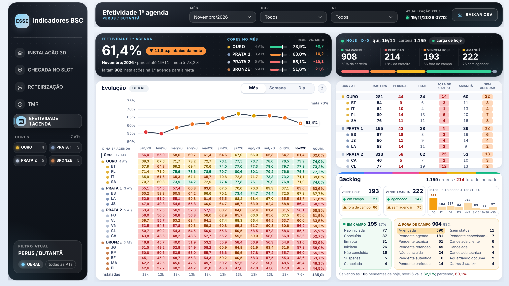
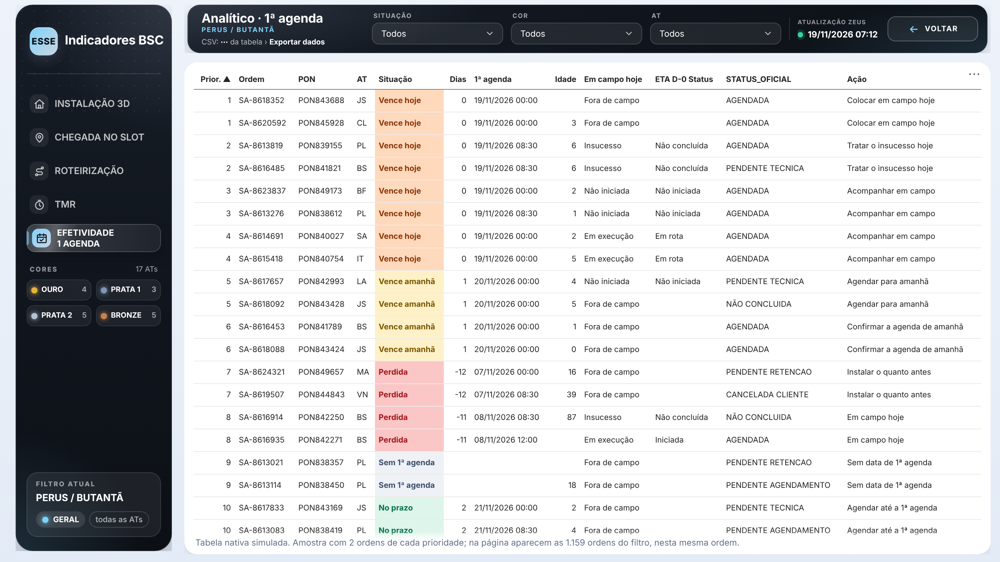
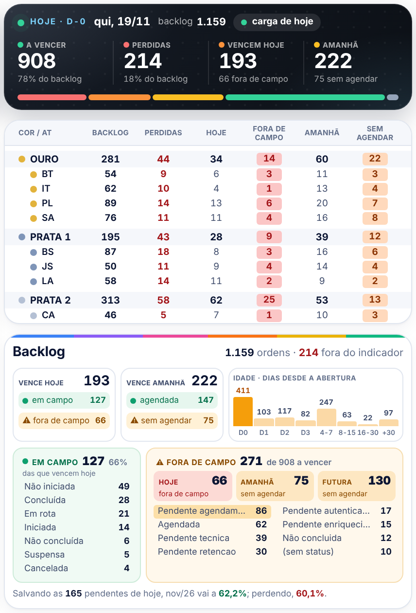
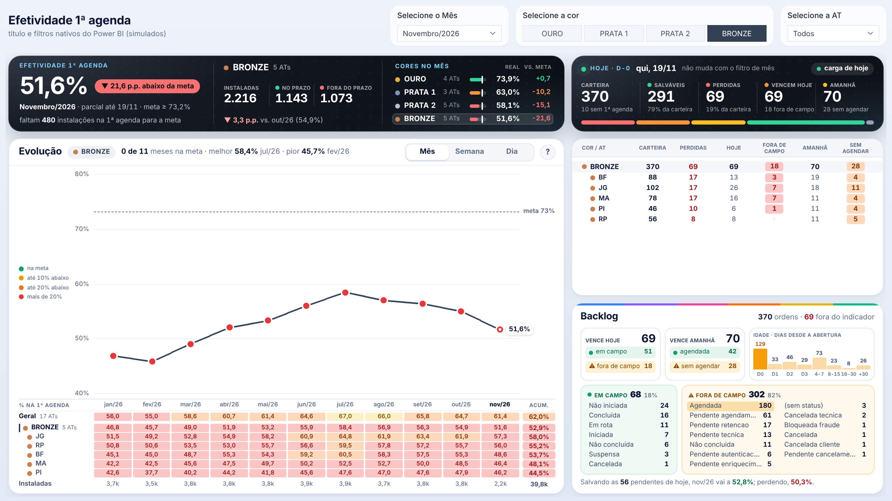
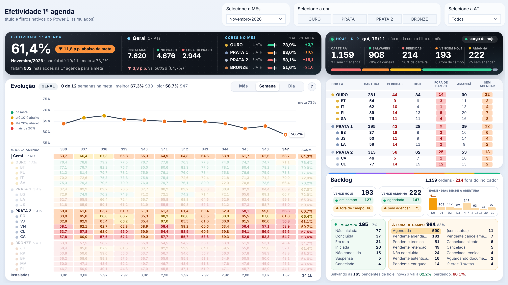
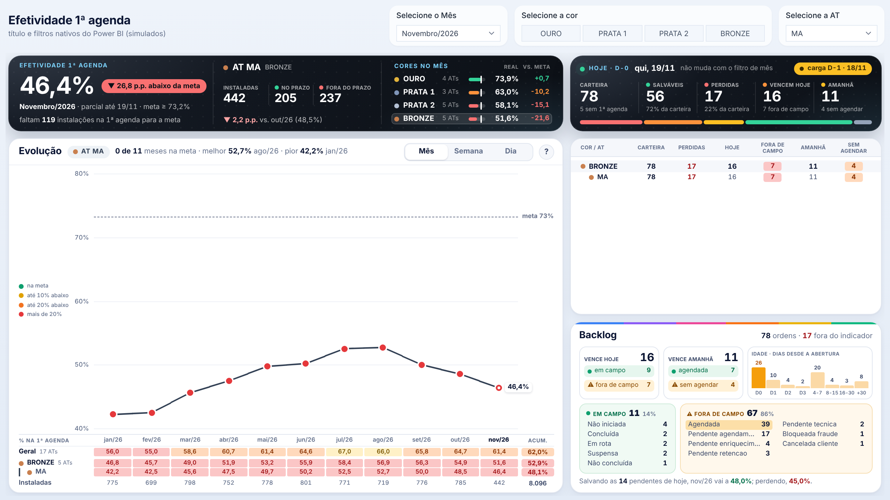
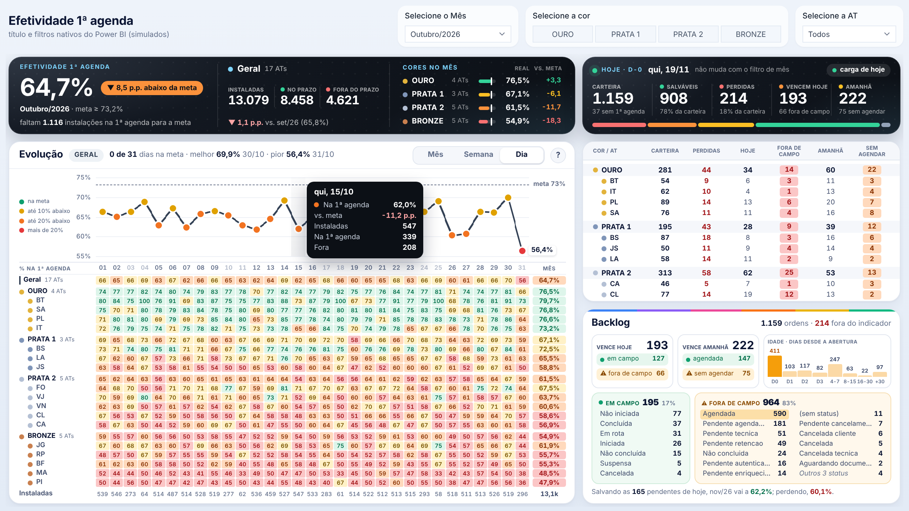
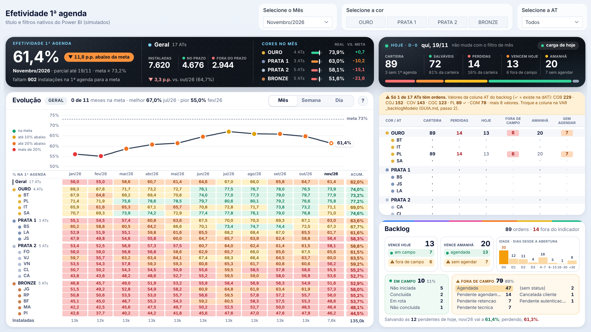

# Painel · Efetividade 1ª agenda

> **Comece pelo [GUIA.md](GUIA.md)**: lista tudo o que criar (tabela, medidas, páginas, botões), na ordem, e como corrigir a coluna da AT do backlog.

Página nova do painel de instalação, no mesmo modelo da **Instalação em até 3 dias**: um visual **HTML Content** gerado por uma medida DAX, a barra de cima com a **data da atualização** e o botão **Baixar CSV**, a página do **analítico** (oculta, uma tabela para baixar as ordens) e o **menu v2** com o item novo.

O indicador: a instalação vendida tem de ser feita até a data que o cliente pediu na 1ª agenda (vendeu 19/11, cliente pediu 20/11 08:30 → instalar até 20/11). Resultado = `'f1AGENDA_PRAZO'[num_Total]` ÷ `'f1AGENDA_TOTAL'[num_Total]`, a mesma conta da sua `% 1_AGENDA`.

- **Lado esquerdo** (segue o filtro de mês): resultado do mês contra a meta de 73,2%, curva por **Mês | Semana | Dia** e abertura por **cor** e por **AT**.
- **Lado direito** (fixo em **D-0**, lê a `BACKLOG_INSTALACAO`): o que ainda dá para salvar e o que já perdemos, o quadro por cor e AT e o **card Backlog** — vence hoje (em campo × fora de campo), vence amanhã (agendada × sem agendar), idade desde a abertura, em campo por status da ETA DIRECT D-0 e fora de campo por `STATUS_OFICIAL`.
- **Barra**: filtros, **Atualização Zeus** (verde quando a carga é de hoje) e **Baixar CSV**, que abre o analítico.
- **Analítico**: página oculta, fora do menu. Tabela nativa com as mesmas regras, ordem a ordem, pronta para **Exportar dados** em CSV.



## Arquivos

| Arquivo | O que é | Onde colar |
|---|---|---|
| [`index.html`](index.html) | **Página única: prévia interativa + todo o código + passo a passo.** Baixe e abra no navegador. | — |
| [`medidas_de_apoio_1agenda_v1.txt`](medidas_de_apoio_1agenda_v1.txt) | `1_AGENDA NO PRAZO`, `1_AGENDA TOTAL` e, opcional, a `% 1_AGENDA` com `DIVIDE` | Nova medida (uma por vez) |
| [`painel_efetividade_1agenda_html_v1.txt`](painel_efetividade_1agenda_html_v1.txt) | medida **Painel Efetividade 1 Agenda HTML** (o corpo da página) | Nova medida |
| [`barra_filtros_1agenda_html_v1.txt`](barra_filtros_1agenda_html_v1.txt) | barra de cima da página do painel: filtros, atualização e Baixar CSV | Nova medida |
| [`analitico_1agenda_v1.txt`](analitico_1agenda_v1.txt) | tabela `Seletor Situacao 1AG` + 10 medidas `1AG …` da tabela para baixar | Nova tabela + Nova medida |
| [`barra_filtros_analitico_1agenda_html_v1.txt`](barra_filtros_analitico_1agenda_html_v1.txt) | barra da página do analítico: dica de como baixar e botão Voltar | Nova medida |
| [`menu_lateral_instalacao_html_v2.txt`](menu_lateral_instalacao_html_v2.txt) | menu com **EFETIVIDADE 1 AGENDA** (substitui o v1) | nas medidas de menu das 5 páginas e do analítico |
| [`GUIA.md`](GUIA.md) | **guia de montagem**: o que criar, na ordem, com as posições e a correção da coluna da AT | — |
| `1-…png` a `12-…png` | prints da prévia com dados fictícios (hoje = quinta, 19/11) | — |

## O que trocar no seu modelo

Tudo que a medida principal lê do modelo está nas VARs marcadas com `<<< MODELO`. Estes pontos eu não consegui ver nos prints:

| O que | Onde | Como está | O que fazer |
|---|---|---|---|
| **AT do backlog** | `_backlogModelo` → `"AT"` **e** a medida `1AG No Filtro` | `[CENTRAL_OFFICE]` | **Trocar.** Tem que trazer as mesmas siglas da `dAT[AREA ]`, como a `'ETA DIRECT D-0'[AT]` da 3D. A `CENTRAL_OFFICE` não é: só a LP bateu. O painel lista os valores que a coluna trouxe (prints 9 e 12). Veja o passo 2 do [GUIA.md](GUIA.md). |
| Abertura da ordem | `_backlogModelo` → `"Abertura"` e a medida `1AG Idade` | `[DATA_ABERTURA]` | Usada só na idade do card. Se a data da venda estiver em outra coluna, troque nos dois lugares. |
| Atualização | `_atualizacao` nas duas barras | `MAX( [DATA_CARGA] )` | Se tiver uma coluna com a hora da carga da Zeus, use ela (aparece data e hora). Sem hora, mostra só a data. |
| Meta | `_meta` | `0.732` | É a meta do 1 AGENDA no BSC. Confira. |
| Status agendado | `_statusAgendado` e a medida `1AG Agendamento` | `"AGENDAD"` | Começo do `STATUS_OFICIAL`: pega Agendada (como no seu print) e Agendado. Vazio conta como sem agendar. |
| Status de campo | `_campoCfg` e a medida `1AG Situação em Campo` | os 7 status do seu print | Status que não estiver na lista conta como “não iniciada”. |
| Data da carga | `_dataCarga` | `MAX( [DATA_CARGA] )` | Mostra “carga de hoje” / “carga D-1” no topo do lado direito. Se a coluna não for a data da carga, troque por `BLANK()`. |
| Canceladas | comentário na `_backlogModelo` | sem filtro | Se o backlog trouxer canceladas, use o `FILTER` com `DATA_CANCELAMENTO` que está no comentário. |
| Relacionamentos | `f1AGENDA_PRAZO` e `f1AGENDA_TOTAL` | — | Os mesmos da sua `% 1_AGENDA` (dCalendario e dAT). O backlog **não** precisa de relacionamento. |

## Como montar

### 1. Página do painel
1. Crie `1_AGENDA NO PRAZO` e `1_AGENDA TOTAL` (arquivo de medidas de apoio).
2. Crie a medida **Painel Efetividade 1 Agenda HTML** e a **Barra Filtros 1 Agenda HTML**.
3. **Duplique a página da Instalação 3D** e renomeie para `EFETIVIDADE 1 AGENDA` (menu, barra e segmentações já vêm). No visual do corpo, troque a medida pela do painel; na barra de cima, pela barra nova.
4. Tamanhos: menu 200 × 700 em (20, 6); barra 1032 × 62 em (236, 6); painel 1032 × 630 em (236, 80). Sem título, fundo transparente.
5. Filtros: mês, cor e AT. O lado direito ignora o mês sozinho.
6. Confira: o número grande do mês = sua `% 1_AGENDA` com o mesmo filtro; a carteira = linhas do backlog nas ATs do filtro.

### 2. Barra e botão Baixar CSV
O Power BI não tem ação de botão que baixe um arquivo. O **Baixar CSV** é um botão nativo transparente que abre a página do analítico; lá a tabela é exportada.

1. **Segmentações** (Lista suspensa) reposicionadas: 160 × 26 px, a 24 px do topo da barra. Da borda **direita** da barra até a borda esquerda de cada uma: **AT 432 px**, **Cor 610 px**, **Mês 788 px**.
2. **Botão nativo** (Inserir › Botões › Em branco) em cima do Baixar CSV: **116 × 32 px**, a **132 px** da borda direita e 15 px do topo. Ação › **Navegação de página** › `ANALÍTICO 1 AGENDA`. Preenchimento transparente; em “Ao passar o mouse”, branco com 85% de transparência.
3. Traga as segmentações e o botão para a frente.


### 3. Página do analítico (oculta, uma tabela)
1. **Modelagem › Nova tabela** com o bloco `Seletor Situacao 1AG`. Classifique `Situação 1AG` por `Ordem Situação 1AG`. Sem relacionamento.
2. **Nova medida** para cada `1AG …` do arquivo `analitico_1agenda_v1.txt`.
3. Duplique a página do painel, renomeie para `ANALÍTICO 1 AGENDA`, apague o painel e coloque um visual **Tabela** no lugar (236, 80, 1032 × 630). Botão direito na aba da página › **Ocultar página**.
4. Colunas, nesta ordem: `1AG Prioridade`, número da ordem, PON, AT, `1AG Situação`, `1AG Dias até a 1ª Agenda`, `DATA_PRIMEIRA_AGENDA`, `1AG Idade`, `1AG Situação em Campo`, `ETA DIRECT D-0.Status`, `STATUS_OFICIAL`, `1AG Ação`. Se quiser: `DATA_ABERTURA`, `DATA_AGENDADA`, `CIDADE`, `CONTRACTOR`.
5. Classifique por `1AG Prioridade`, crescente.
6. **Filtros neste visual:** `1AG No Filtro` → mostrar itens quando o valor é **1** (segue o seletor de situação e o filtro de cor/AT, mesmo sem relacionamento com a dAT).
7. **Formatação condicional** de `1AG Situação`: cor da tela de fundo → valor do campo → `1AG Cor Fundo`; cor da fonte → valor do campo → `1AG Cor Texto`.
8. **Totais** desligados.
9. Barra: troque a medida por **Barra Filtros Analitico 1 Agenda HTML**; segmentações nas três caixas (mesmas posições): `'Seletor Situacao 1AG'[Situação 1AG]`, `dAT[COR_AREA ]`, `dAT[AREA ]`. Sem filtro de mês (a carteira é de hoje). No botão nativo do canto, Ação › **Voltar**.
10. Menu: o mesmo, com `_paginaAtual = "EFETIVIDADE 1 AGENDA"`.
11. Para abrir já com a cor e a AT do painel: Exibir › **Sincronizar segmentações** e marque as duas páginas nas segmentações de cor e AT.
12. Para baixar: passe o mouse na tabela → **⋯ Mais opções** → **Exportar dados** → **Dados resumidos** → **.csv**. No serviço, a exportação precisa estar liberada no relatório e pelo administrador.



### 4. Menu (todas as páginas)
Cole `menu_lateral_instalacao_html_v2.txt` e troque só `_paginaAtual`: `"INSTALAÇÃO 3D"`, `"CHEGADA NO SLOT"`, `"ROTEIRIZAÇÃO"`, `"TMR"` ou `"EFETIVIDADE 1 AGENDA"` (também no analítico). A marca (`ESSE` / `Indicadores BSC`) é a do arquivo que você mandou. O item novo entra **no fim**, então os 4 botões nativos que já existem não mudam de lugar:

| Botão nativo | Topo (a partir do topo do menu) | |
|---|---|---|
| INSTALAÇÃO 3D | 109 | não muda |
| CHEGADA NO SLOT | 152 | não muda |
| ROTEIRIZAÇÃO | 195 | não muda |
| TMR | 238 | não muda |
| **EFETIVIDADE 1 AGENDA** | **281** | **novo** · Ação › Navegação de página |

Todos com 172 × 36 px, a 14 px da borda esquerda do menu. Nome com mais de 16 letras quebra em duas linhas no primeiro espaço, sem cortar. O v2 também corrige o til que cortava em INSTALAÇÃO e ROTEIRIZAÇÃO.


## Regras do lado direito

Cada ordem do backlog, comparando a **data** da `DATA_PRIMEIRA_AGENDA` com hoje (fuso de Brasília):

| Situação | Regra |
|---|---|
| Perdida | 1ª agenda antes de hoje (conta contra o indicador quando for instalada) |
| Vence hoje | 1ª agenda hoje |
| Vence amanhã | 1ª agenda amanhã |
| No prazo | depois de amanhã |
| Sem 1ª agenda | data vazia |

- **Em campo hoje** = `[ETA DIRECT D-0.Status]` preenchida. Em branco = **fora de campo**. Grupos: concluída · em execução (em rota, iniciada) · não iniciada · insucesso (não concluída, suspensa, cancelada).
- **Sem agendar** = vence amanhã e `STATUS_OFICIAL` que não começa com AGENDAD (vazio conta como sem agendar).
- **Idade** = hoje − `DATA_ABERTURA`, em dias corridos, nas faixas D0, D1, D2, D3, 4-7, 8-15, 16-30 e +30.
- **Fora de campo por status:** o maior fica destacado; passou de 14 status, os menores viram “Outros N status”.
- O prazo vale o **dia todo** da 1ª agenda.
- **Salvando / perdendo** (rodapé do card): pendentes = vencem hoje e não concluídas. Salvando = (no prazo do mês + pendentes) ÷ (baixadas do mês + pendentes); perdendo = no prazo do mês ÷ (baixadas do mês + pendentes). Sempre o mês atual, na seleção de cor/AT. É estimativa: baixas fora da carteira não entram.
- O analítico usa exatamente as mesmas regras; a prévia confere que os números da tabela batem com os do painel e com cada número do card.

## Outros prints

| | |
|---|---|
| Visão geral (visual de 1264 × 638, sem o menu) |  |
| Card Backlog no tamanho da página (1032 × 630) |  |
| Cor BRONZE |  |
| Curva semanal + destaque de uma cor |  |
| Uma AT, com aviso de carga de ontem |  |
| Mês fechado: só o lado esquerdo muda |  |
| Coluna da AT do backlog não bate com a dAT |  |
| Coluna da AT errada: só uma AT bate (faixa amarela com os valores da coluna) |  |

## Regerar a prévia

```
node tools/dax-preview/build-1agenda.js
```

Lê os `.txt` desta pasta, confere a sintaxe de todas as medidas, avalia o painel com os dados fictícios de `tools/dax-preview/mocks-1agenda.js`, confere que as medidas do analítico dão os mesmos números do painel e do card (geral, uma cor e uma AT), testa os botões, a posição das segmentações, do botão da barra e dos itens do menu e os tamanhos 1264 × 638 e 1032 × 630 (nada cortado, rótulos da idade sem encostar) e regrava os prints e o `index.html`. A prévia não substitui o teste no Power BI com os dados reais.
