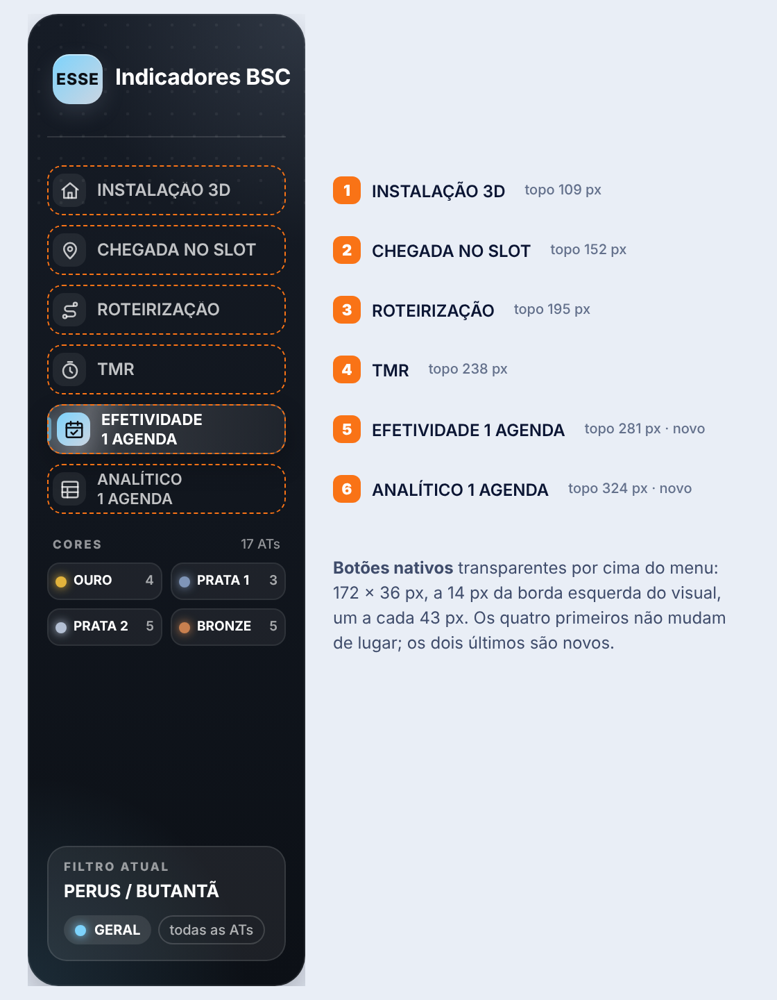
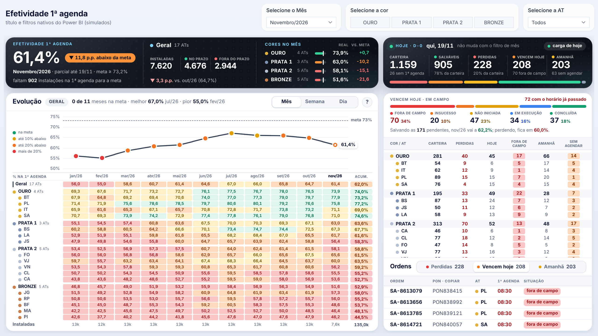
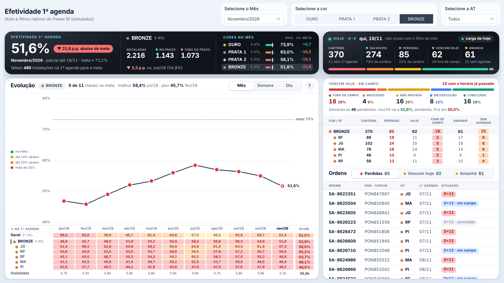
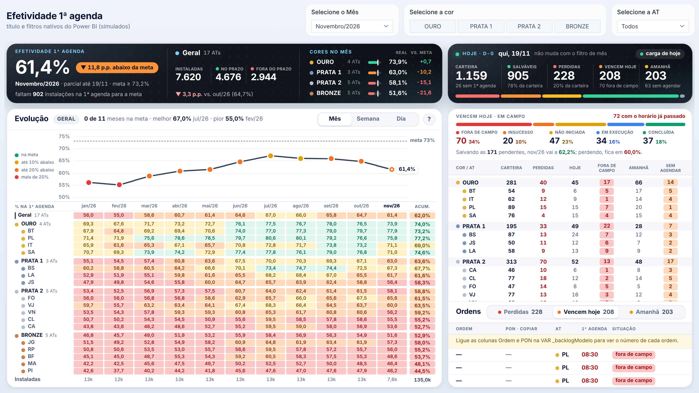
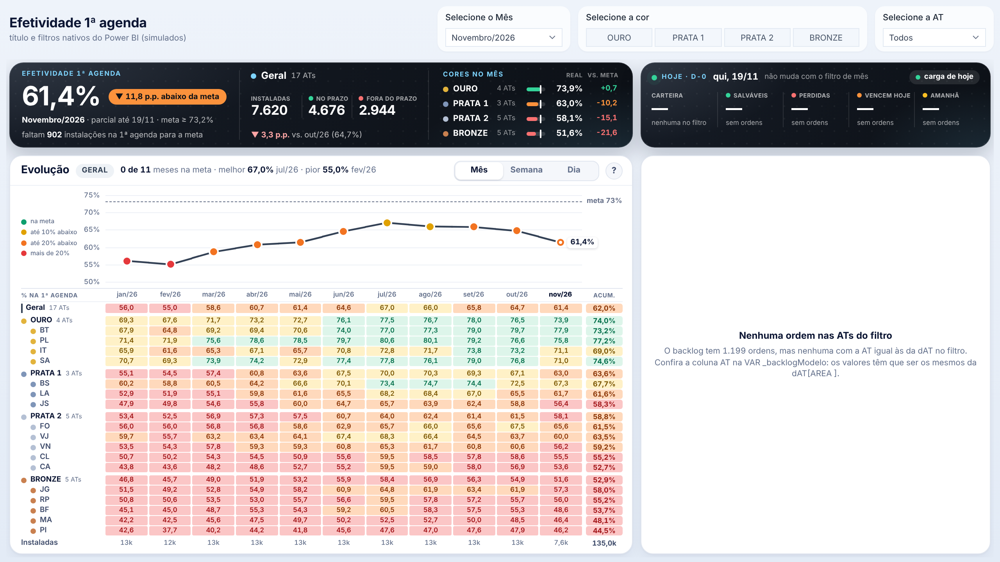

# Painel · Efetividade 1ª agenda

Página nova do painel de instalação, no mesmo modelo da **Instalação em até 3 dias**: um visual **HTML Content** gerado por uma medida DAX, mais a página do **analítico** (uma tabela para baixar as ordens) e o **menu v2** com as duas páginas novas.

O indicador: a instalação vendida tem de ser feita até a data que o cliente pediu na 1ª agenda (vendeu 19/11, cliente pediu 20/11 08:30 → instalar até 20/11). Resultado = `'f1AGENDA_PRAZO'[num_Total]` ÷ `'f1AGENDA_TOTAL'[num_Total]`, a mesma conta da sua `% 1_AGENDA`.

- **Lado esquerdo** (segue o filtro de mês): resultado do mês contra a meta de 73,2%, curva por **Mês | Semana | Dia** e abertura por **cor** e por **AT**.
- **Lado direito** (fixo em **D-0**, lê a `BACKLOG_INSTALACAO`): o que ainda dá para salvar e o que já perdemos, quantas **vencem hoje** e quantas delas estão **fora de campo** (`[ETA DIRECT D-0.Status]` em branco), quantas **vencem amanhã** sem `STATUS_OFICIAL` = AGENDADO, quanto o mês fica salvando ou perdendo as de hoje, tudo por cor e AT, e a lista das ordens.
- **Analítico**: tabela nativa com as mesmas regras, ordem a ordem, pronta para **Exportar dados**.


## Arquivos

| Arquivo | O que é | Onde colar |
|---|---|---|
| [`index.html`](index.html) | **Página única: prévia interativa + todo o código + passo a passo.** Baixe e abra no navegador. | — |
| [`medidas_de_apoio_1agenda_v1.txt`](medidas_de_apoio_1agenda_v1.txt) | `1_AGENDA NO PRAZO`, `1_AGENDA TOTAL` e, opcional, a `% 1_AGENDA` com `DIVIDE` | Nova medida (uma por vez) |
| [`painel_efetividade_1agenda_html_v1.txt`](painel_efetividade_1agenda_html_v1.txt) | medida **Painel Efetividade 1 Agenda HTML** (o corpo da página) | Nova medida |
| [`barra_filtros_1agenda_html_v1.txt`](barra_filtros_1agenda_html_v1.txt) | barra escura de cima da página do painel (por baixo das segmentações) | Nova medida |
| [`analitico_1agenda_v1.txt`](analitico_1agenda_v1.txt) | tabela `Seletor Situacao 1AG` + 9 medidas `1AG …` da tabela para baixar | Nova tabela + Nova medida |
| [`barra_filtros_analitico_1agenda_html_v1.txt`](barra_filtros_analitico_1agenda_html_v1.txt) | barra da página do analítico, com a dica de como baixar | Nova medida |
| [`menu_lateral_instalacao_html_v2.txt`](menu_lateral_instalacao_html_v2.txt) | menu com **EFETIVIDADE 1 AGENDA** e **ANALÍTICO 1 AGENDA** (substitui o v1) | nas medidas de menu das 6 páginas |
| `1-…png` a `11-…png` | prints da prévia com dados fictícios (hoje = quinta, 19/11) | — |

## O que trocar no seu modelo

Tudo que a medida principal lê do modelo está nas VARs marcadas com `<<< MODELO`. Estes pontos eu não consegui ver nos prints:

| O que | Onde | Como está | O que fazer |
|---|---|---|---|
| **Número da ordem** | `_backlogModelo` → `"Ordem"` | `BLANK()` | **Trocar** por `"" & 'BACKLOG_INSTALACAO'[coluna do número]`. Até trocar, a lista mostra “—” e avisa (print 9). |
| **PON** | `_backlogModelo` → `"PON"` | `BLANK()` | **Trocar** pela coluna do PON, no mesmo formato. |
| **AT do backlog** | `_backlogModelo` → `"AT"` **e** a medida `1AG No Filtro` | `[CENTRAL_OFFICE]` | **Confirmar.** Tem que trazer as mesmas siglas da `dAT[AREA ]`. Se não bater, o painel avisa (print 10). Troque nos dois lugares. |
| Meta | `_meta` | `0.732` | É a meta do 1 AGENDA no BSC. Confira. |
| Status agendado | `_statusAgendado` e a medida `1AG Agendamento` | `"AGENDADO"` | Texto exato do `STATUS_OFICIAL` (maiúsculas não importam). |
| Status de campo | `_campoCfg` e a medida `1AG Situação em Campo` | os 7 status do seu print | Status que não estiver na lista conta como “não iniciada”. |
| Data da carga | `_dataCarga` | `MAX( [DATA_CARGA] )` | Mostra “carga de hoje” / “carga D-1”. Se a coluna não for a data da carga, troque por `BLANK()`. |
| Canceladas | comentário na `_backlogModelo` | sem filtro | Se o backlog trouxer canceladas, use o `FILTER` com `DATA_CANCELAMENTO` que está no comentário. |
| Relacionamentos | `f1AGENDA_PRAZO` e `f1AGENDA_TOTAL` | — | Os mesmos da sua `% 1_AGENDA` (dCalendario e dAT). O backlog **não** precisa de relacionamento. |

## Como montar

### 1. Página do painel
1. Crie `1_AGENDA NO PRAZO` e `1_AGENDA TOTAL` (arquivo de medidas de apoio).
2. Crie a medida **Painel Efetividade 1 Agenda HTML** e a **Barra Filtros 1 Agenda HTML**.
3. **Duplique a página da Instalação 3D** e renomeie para `EFETIVIDADE 1 AGENDA` (menu, barra e segmentações já vêm). No visual do corpo, troque a medida pela do painel; na barra de cima, pela barra nova.
4. Tamanhos dos prints: menu 200 × 700 em (20, 6); barra 1032 × 62 em (236, 6); painel 1032 × 630 em (236, 80). Sem título, fundo transparente.
5. Filtros: mês, cor e AT. O lado direito ignora o mês sozinho.
6. Confira: o número grande do mês = sua `% 1_AGENDA` com o mesmo filtro; a carteira = linhas do backlog nas ATs do filtro.

### 2. Página do analítico (uma tabela)
1. **Modelagem › Nova tabela** com o bloco `Seletor Situacao 1AG`. Classifique `Situação 1AG` por `Ordem Situação 1AG`. Sem relacionamento.
2. **Nova medida** para cada `1AG …` do arquivo `analitico_1agenda_v1.txt`.
3. Duplique a página do painel, renomeie para `ANALÍTICO 1 AGENDA`, apague o painel e coloque um visual **Tabela** no lugar (236, 80, 1032 × 630).
4. Colunas, nesta ordem: `1AG Prioridade`, número da ordem, PON, AT, `1AG Situação`, `1AG Dias até a 1ª Agenda`, `DATA_PRIMEIRA_AGENDA`, `1AG Situação em Campo`, `ETA DIRECT D-0.Status`, `STATUS_OFICIAL`, `1AG Ação`. Se quiser: `DATA_ABERTURA`, `DATA_AGENDADA`, `CIDADE`, `CONTRACTOR`.
5. Classifique por `1AG Prioridade`, crescente.
6. **Filtros neste visual:** `1AG No Filtro` → mostrar itens quando o valor é **1** (segue o seletor de situação e o filtro de cor/AT, mesmo sem relacionamento com a dAT).
7. **Formatação condicional** de `1AG Situação`: cor da tela de fundo → valor do campo → `1AG Cor Fundo`; cor da fonte → valor do campo → `1AG Cor Texto`.
8. **Totais** desligados.
9. Barra: troque a medida por **Barra Filtros Analitico 1 Agenda HTML**; segmentações nas três caixas: `'Seletor Situacao 1AG'[Situação 1AG]`, `dAT[COR_AREA ]`, `dAT[AREA ]`. Sem filtro de mês (a carteira é de hoje).
10. Para baixar: passe o mouse na tabela → **⋯ Mais opções** → **Exportar dados** → **Dados com layout atual** (.xlsx). No serviço, a exportação precisa estar liberada no relatório e pelo administrador.


### 3. Menu (todas as páginas)
Cole `menu_lateral_instalacao_html_v2.txt` nas 6 páginas e troque só `_paginaAtual`: `"INSTALAÇÃO 3D"`, `"CHEGADA NO SLOT"`, `"ROTEIRIZAÇÃO"`, `"TMR"`, `"EFETIVIDADE 1 AGENDA"` ou `"ANALÍTICO 1 AGENDA"`. A marca (`ESSE` / `Indicadores BSC`) é a do arquivo que você mandou. Os itens novos entram **no fim**, então os 4 botões nativos que já existem não mudam de lugar:

| Botão nativo | Topo (a partir do topo do menu) | |
|---|---|---|
| INSTALAÇÃO 3D | 109 | não muda |
| CHEGADA NO SLOT | 152 | não muda |
| ROTEIRIZAÇÃO | 195 | não muda |
| TMR | 238 | não muda |
| **EFETIVIDADE 1 AGENDA** | **281** | **novo** · Ação › Navegação de página |
| **ANALÍTICO 1 AGENDA** | **324** | **novo** · Ação › Navegação de página |

Todos com 172 × 36 px, a 14 px da borda esquerda do menu. Nome com mais de 16 letras quebra em duas linhas no primeiro espaço, sem cortar.



## Regras do lado direito

Cada ordem do backlog, comparando a **data** da `DATA_PRIMEIRA_AGENDA` com hoje (fuso de Brasília):

| Situação | Regra |
|---|---|
| Perdida | 1ª agenda antes de hoje (conta contra o indicador quando for instalada) |
| Vence hoje | 1ª agenda hoje |
| Vence amanhã | 1ª agenda amanhã |
| No prazo | depois de amanhã |
| Sem 1ª agenda | data vazia |

- **Em campo hoje** = `[ETA DIRECT D-0.Status]` preenchida. Em branco = **fora de campo**. Grupos: concluída · em execução (em rota, iniciada) · não iniciada · insucesso (não concluída, suspensa, cancelada).
- **Sem agendar** = vence amanhã e `STATUS_OFICIAL` diferente de AGENDADO.
- O prazo vale o **dia todo** da 1ª agenda; a hora só ordena a lista e fica vermelha quando já passou e a ordem não foi concluída.
- **Salvando / perdendo:** pendentes = vencem hoje e não concluídas. Salvando = (no prazo do mês + pendentes) ÷ (baixadas do mês + pendentes); perdendo = no prazo do mês ÷ (baixadas do mês + pendentes). Sempre o mês atual, na seleção de cor/AT. É estimativa: baixas fora da carteira não entram.
- O analítico usa exatamente as mesmas regras; a prévia confere que os números da tabela batem com os do painel.

## Outros prints

| | |
|---|---|
| Visão geral (visual de 1264 × 638) |  |
| Aba Amanhã: as sem agendar primeiro |  |
| Cor BRONZE, aba Perdidas |  |
| Curva semanal + destaque de uma cor |  |
| Uma AT, com aviso de carga de ontem |  |
| Mês fechado: só o lado esquerdo muda |  |
| Como vem ao colar (Ordem e PON ainda não ligados) |  |
| Coluna da AT do backlog não bate com a dAT |  |

## Regerar a prévia

```
node tools/dax-preview/build-1agenda.js
```

Lê os `.txt` desta pasta, confere a sintaxe de todas as medidas, avalia o painel com os dados fictícios de `tools/dax-preview/mocks-1agenda.js`, confere que as medidas do analítico dão os mesmos números do painel (geral, uma cor e uma AT), testa os botões, a posição dos itens do menu e os tamanhos 1264 × 638 e 1032 × 630 (nada cortado) e regrava os prints e o `index.html`. A prévia não substitui o teste no Power BI com os dados reais.
