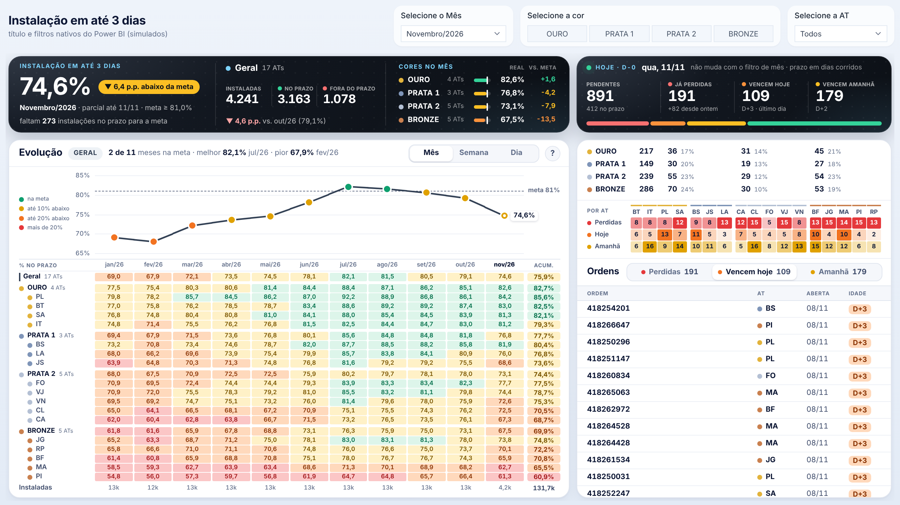
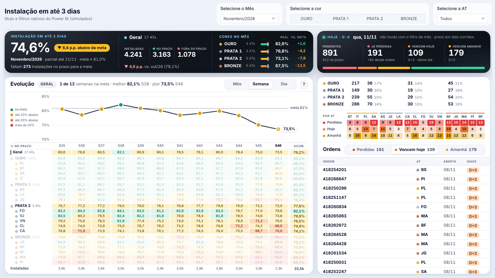
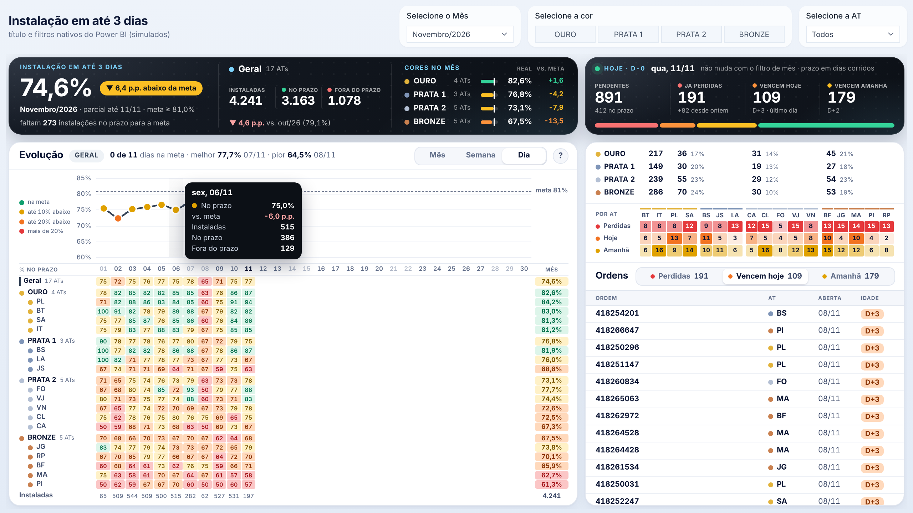
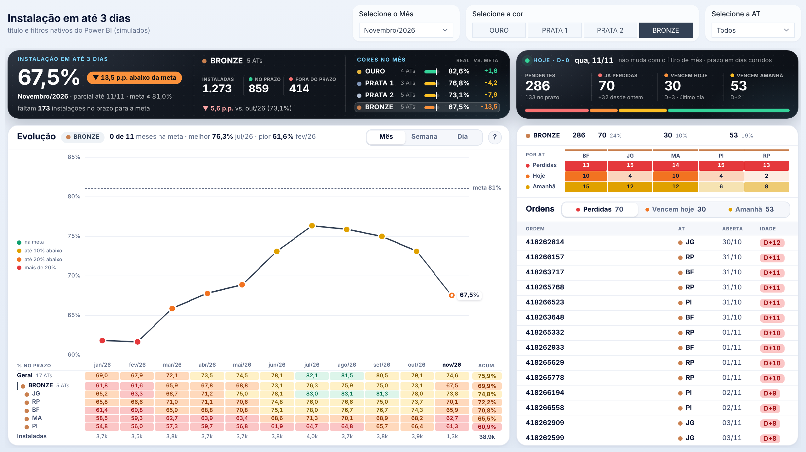
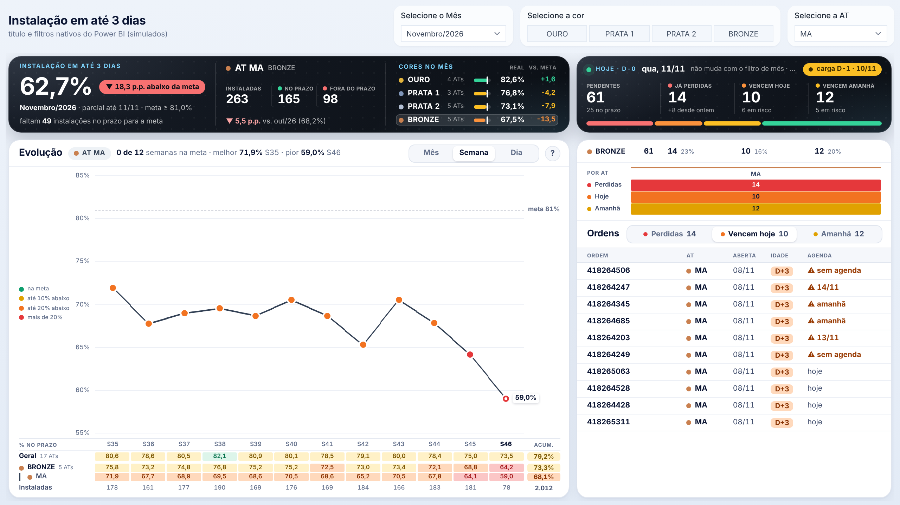
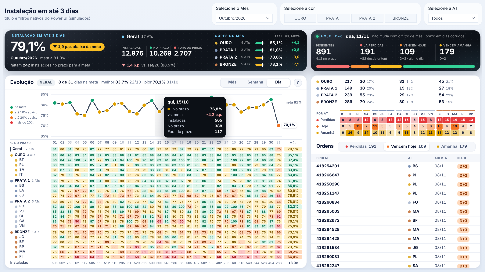
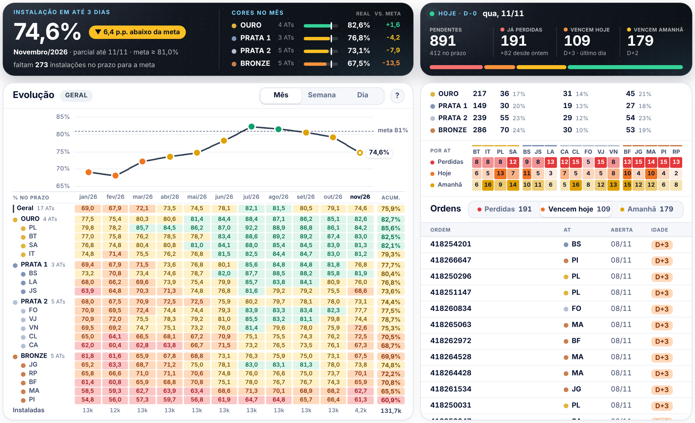
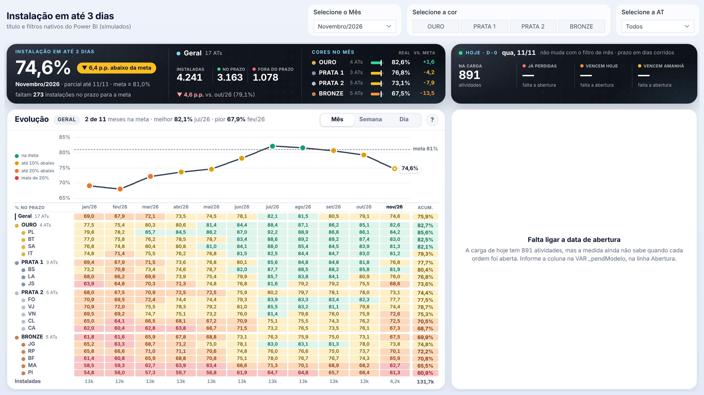

# Painel · Instalação em até 3 dias

Um único visual **HTML Content** para o Power BI, gerado por uma medida DAX.

- **Lado esquerdo** (segue o filtro de mês): resultado do mês, curva por **Mês | Semana | Dia** e abertura por **cor** e por **AT**.
- **Lado direito** (fixo em **D-0**): ordens pendentes na carga de hoje (`'ETA DIRECT D-0'`) — já perdidas, vencem hoje, vencem amanhã — por cor, por AT e a lista das ordens.

Versão 1.2: usa as tabelas do arquivo novo (`'fINSTALACAO + ME_3D'`, `'fINSTALACAO + ME_3D_TOTAL'`, `dCalendario`, `'ETA DIRECT D-0'`) e não perde mais o CSS em visuais HTML que filtram o conteúdo.



## Arquivos

| Arquivo | O que é |
|---|---|
| [`index.html`](index.html) | **Página única: prévia interativa + todo o código + passo a passo.** Baixe e abra no navegador. |
| [`painel_instalacao_3d_html_v1.txt`](painel_instalacao_3d_html_v1.txt) | Medida principal (vai no visual HTML Content). |
| [`medidas_de_apoio_v1.txt`](medidas_de_apoio_v1.txt) | `INSTALACAO_3D NO PRAZO`, `INSTALACAO_3D TOTAL` e, opcional, a `% INSTALACAO_3D` reescrita com `DIVIDE`. |
| `1-…png` a `8-…png` | Prints da prévia com dados fictícios. |

## Como montar

1. Crie `INSTALACAO_3D NO PRAZO` e `INSTALACAO_3D TOTAL` (numerador e denominador da sua `% INSTALACAO_3D`).
2. Crie a medida principal. O lado esquerdo já funciona com os nomes do seu modelo.
3. Coloque a medida no visual HTML (de preferência o mesmo dos outros painéis), sem título e com fundo transparente. Tamanho de referência: 1264 × 638 px.
4. Filtros da página: mês, cor e AT. O lado direito ignora o mês sozinho.
5. Confira se o número grande do mês bate com a sua `% INSTALACAO_3D`.

## O que ainda falta (lado direito)

- **Data em que a ordem foi gerada** na `'ETA DIRECT D-0'`: troque o `BLANK()` da linha `"Abertura"` na VAR `_pendModelo`. Sem ela o lado direito mostra um aviso (print 8). A `[Data Agendada para Execução]` já está ligada como agenda.
- **Filtro de instalações pendentes**, se a carga trouxer reparos ou atividades concluídas.
- **Dias corridos ou úteis:** está em dias corridos (`_prazoEmDiasUteis = FALSE()`).

## Se aparecer só texto, sem formatação

O visual descartou o bloco de CSS. A v1.2 já evita os dois motivos conhecidos (o `<style>` na frente de tudo e o sinal de menor dentro do CSS). Se ainda acontecer, copie um visual HTML de um dos outros painéis para este arquivo e troque só a medida.

O mapa completo dos nomes usados e as regras de cálculo estão no `index.html`.

## Outros prints

| | |
|---|---|
| Curva semanal + destaque de uma cor |  |
| Curva diária + dica do ponto |  |
| Cor BRONZE, aba de ordens perdidas |  |
| Uma AT, com as colunas opcionais (agenda e data da carga) |  |
| Mês fechado: só o lado esquerdo muda |  |
| Visual estreito (ao lado de um menu) |  |
| Como aparece ao colar hoje (falta a abertura) |  |

## Regerar a prévia

```
node tools/dax-preview/build-instalacao.js
```

Lê os dois `.txt` desta pasta, confere a sintaxe, avalia a medida com os dados fictícios de `tools/dax-preview/mocks-instalacao.js`, testa os botões e o tamanho de referência e regrava os prints e o `index.html`. A prévia não substitui o teste no Power BI com os dados reais.
