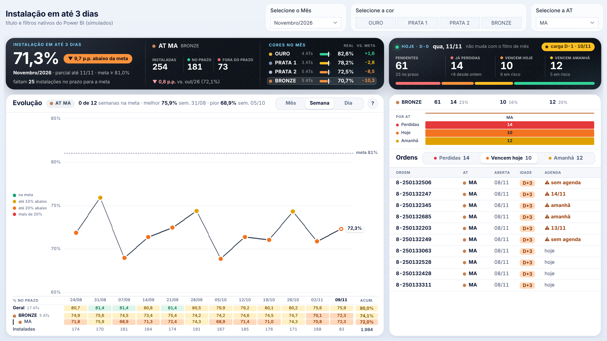

# Painel · Instalação em até 3 dias

Um único visual **HTML Content** para o Power BI, gerado por uma medida DAX.

- **Lado esquerdo** (segue o filtro de mês): resultado do mês, curva por **Mês | Semana | Dia** e abertura por **cor** e por **AT**.
- **Lado direito** (fixo em **D-0**): ordens pendentes na carga de hoje — já perdidas, vencem hoje, vencem amanhã — por cor, por AT e a lista das ordens.


## Arquivos

| Arquivo | O que é |
|---|---|
| [`index.html`](index.html) | **Página única: prévia interativa + todo o código + passo a passo.** Baixe e abra no navegador. |
| [`painel_instalacao_3d_html_v1.txt`](painel_instalacao_3d_html_v1.txt) | Medida principal (vai no visual HTML Content). |
| [`medidas_de_apoio_v1.txt`](medidas_de_apoio_v1.txt) | As 3 medidas de apoio (numerador, denominador e conferência). |
| `1-…png` a `7-…png` | Prints da prévia com dados fictícios. |

## Como montar

1. Crie as medidas de apoio. Se você já tem a medida do indicador, copie dela o numerador e o denominador, mantendo os nomes `[Inst3D No Prazo]` e `[Inst3D Instaladas]`.
2. Crie a medida principal e ajuste as 5 VARs marcadas com `<<< MODELO` (são as únicas que leem tabelas e colunas).
3. Coloque a medida em um visual HTML Content, sem título e com fundo transparente. Tamanho de referência: 1264 × 638 px.
4. Filtros da página: Mês, Cor e AT. O lado direito ignora o mês sozinho.
5. Confira se o número grande do mês bate com a sua medida atual do indicador.

O mapa completo dos nomes usados e as regras de cálculo estão no `index.html`.

## Outros prints

| | |
|---|---|
| Curva semanal + destaque de uma cor |  |
| Curva diária + dica do ponto |  |
| Cor BRONZE, aba de ordens perdidas |  |
| Uma AT, carga de hoje atrasada |  |
| Mês fechado: só o lado esquerdo muda |  |
| Visual estreito (ao lado de um menu) |  |

## Regerar a prévia

```
node tools/dax-preview/build-instalacao.js
```

Lê os dois `.txt` desta pasta, confere a sintaxe, avalia a medida com os dados fictícios de `tools/dax-preview/mocks-instalacao.js`, testa os botões e o tamanho de referência e regrava os prints e o `index.html`. A prévia não substitui o teste no Power BI com os dados reais.
